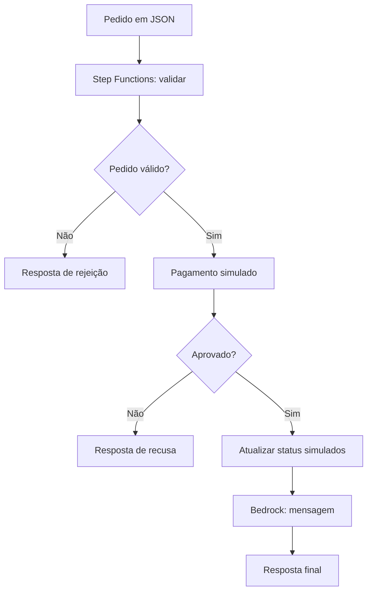

# Assistente de Delivery com AWS Step Functions e Amazon Bedrock

Projeto demonstrativo para o desafio da DIO. Uma máquina de estados recebe um pedido fictício, valida os dados, simula uma aprovação ou recusa de pagamento, percorre os status de entrega e pede ao Amazon Bedrock uma breve mensagem ao cliente. A resposta final mantém os dados do pedido sob controle do código; a IA só redige a mensagem.

> **Estado do projeto:** implementação e simulação local verificadas; implantação e execução na AWS ainda não realizadas. Pagamento, logística e atualização de status são **simulados**. Não use dados reais de clientes nem trate este fluxo como integração com adquirente ou transportadora.

## Arquitetura



| Componente | Papel |
| --- | --- |
| AWS Step Functions | Orquestra decisões, etapas e tratamento de falhas. |
| AWS Lambda (Python) | Valida pedido, simula pagamento, muda status e monta a resposta. |
| Amazon Bedrock (Amazon Nova Lite) | Redige apenas uma mensagem curta de agradecimento. |
| AWS SAM | Define as funções, a máquina de estados e as permissões. |

O endereço é validado, mas não é enviado ao Bedrock nem incluído na resposta. Os preços vêm de um catálogo fixo no código, nunca do valor declarado no pedido. Se a chamada ao Bedrock falhar, o pedido continua com mensagem determinística de reserva.

## Fluxo e resultados

1. **Validar:** verifica identificador, primeiro nome, endereço, itens e quantidades. Recalcula o total pelo catálogo.
2. **Pagamento:** lê `pagamento.resultado_simulado`, que deve ser `APROVADO` ou `RECUSADO`. Nenhuma cobrança ocorre.
3. **Status:** registra, em memória da execução, `EM_PREPARO`, `SAIU_PARA_ENTREGA` e `ENTREGA_SIMULADA`. Nenhum entregador é acionado e não há persistência externa.
4. **Mensagem:** Step Functions chama o Bedrock diretamente com o primeiro nome e a descrição dos itens. Uma função final extrai a mensagem ou usa a reserva.

Pedidos inválidos e pagamentos recusados não chamam o Bedrock. Uma falha no modelo não altera o resultado determinado pelas etapas anteriores.

## Estrutura do repositório

```text
.
├── README.md
├── template.yaml
├── statemachine/
│   └── delivery.asl.json
├── src/
│   └── handler.py
├── examples/
│   ├── order-approved.json
│   ├── order-invalid.json
│   └── order-payment-rejected.json
├── tests/
│   └── test_delivery.py
└── demo_local.py
```

## Executar sem conta AWS

Requer Python 3.11 ou superior. Na pasta do projeto:

```bash
python demo_local.py examples/order-approved.json
python demo_local.py examples/order-invalid.json
python demo_local.py examples/order-payment-rejected.json
python -m unittest discover -s tests -v
```

O simulador usa as mesmas funções de negócio das Lambdas, mas não emula o serviço Step Functions nem chama o Bedrock. Por isso a mensagem vem do texto de reserva.

## Implantação opcional na AWS

Requer AWS CLI e AWS SAM CLI configurados, permissões para criar os recursos e acesso ao modelo Amazon Nova Lite na região escolhida. Confira os custos dos serviços antes de implantar. O exemplo usa `amazon.nova-lite-v1:0`, com corpo de requisição específico do Amazon Nova Lite; outros modelos exigem rever esquema e política IAM.

```bash
sam validate
sam build
sam deploy --guided
```

Depois da implantação, use o ARN da saída `DeliveryStateMachineArn`:

```bash
aws stepfunctions start-execution \
  --state-machine-arn SEU_ARN_AQUI \
  --input file://examples/order-approved.json
```

O comando retorna um `executionArn`. Veja o resultado em **Step Functions → State machines → Executions** ou consulte `aws stepfunctions describe-execution --execution-arn SEU_EXECUTION_ARN`.

`sam deploy` cria recursos na conta e pode gerar cobranças. Para removê-los após o teste, execute `sam delete` com o mesmo stack e região. A implantação não foi executada durante a criação deste repositório.

## Limitações e evolução

- O fluxo avança imediatamente até `ENTREGA_SIMULADA`: não representa o tempo real de preparo e transporte.
- Os status são guardados apenas no estado da execução. Para consultas posteriores, uma evolução seria persistir o pedido com controle de transições e idempotência.
- Para pagamentos reais, substitua a simulação por integração autenticada com um provedor, sem receber dados de cartão nesta máquina de estados.
- Para entregas reais, conecte eventos confirmados da operação antes de marcar um pedido como entregue.

## Referências oficiais

- [Integração Step Functions e Amazon Bedrock](https://docs.aws.amazon.com/step-functions/latest/dg/connect-bedrock.html)
- [Modelo Amazon Nova Lite](https://docs.aws.amazon.com/bedrock/latest/userguide/model-card-amazon-nova-lite.html)
- [Máquinas de estados com AWS SAM](https://docs.aws.amazon.com/step-functions/latest/dg/concepts-sam-sfn.html)
